<div align="center">

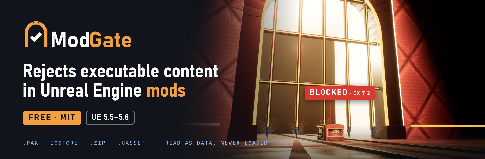

[](LICENSE)
[](#supported-engines-and-platforms)
[](#supported-engines-and-platforms)
[](Source/ModGate)
[](#tests)
[](https://github.com/gregorik/ModGate/releases/latest)
[](https://gregorigin.com/Manuals/ModGate)
[](https://www.fab.com/sellers/GregOrigin)
[](https://discord.gg/nqYQ5mtmHb)
[](https://github.com/gregorik/ModGate/stargazers)

**Checks Unreal Engine mods for anything that can run, before your players load them.**<br>
**Reads `.pak`, IoStore, `.zip` and `.uasset` files as bytes and never loads them. Free, MIT, UE 5.5 to 5.8.**

</div>

---

In July 2026 a Steam Workshop map for *Meccha Chameleon*, a UE5 game, passed review with nothing in its folder but
container files, a preview image and some metadata. Inside the container was a single Blueprint actor, named like an
ambient controller. When a match started it asked the engine for the player's user folder, wrote a batch file into
Documents with the JSON plugin's `ToFile` node, and that batch file fetched a remote-access trojan. There was no
`.exe` for anyone to spot, and the game's first fix, an allow-list of upload file types, didn't stop it.

I read the two write-ups, then the engine source, and built the check I'd want to run on every upload. ModGate opens a
mod the way a hex editor would. It walks the containers and package headers as plain data, lists everything inside
that can execute, and hands you a verdict and an exit code. A data-only mod (meshes, materials, maps that place your
own game's Blueprints) comes back clean. That map's pattern comes back blocked twice: once for the Blueprint script,
and again for the `ToFile` call.

<table>
<tr>
<td width="50%">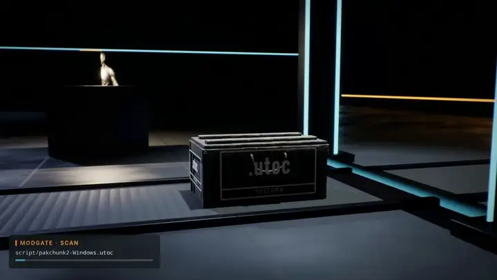</td>
<td width="50%">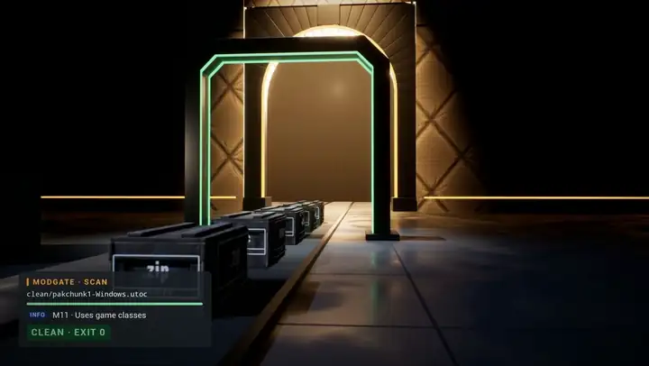</td>
</tr>
<tr>
<td align="center"><b>Blueprint script:</b> blocked, exit 2</td>
<td align="center"><b>Data only:</b> clean, exit 0</td>
</tr>
<tr>
<td width="50%">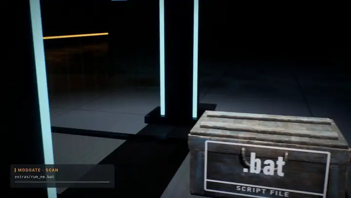</td>
<td width="50%"></td>
</tr>
<tr>
<td align="center"><b>Scripts, disguised programs, plugin code:</b> blocked</td>
<td align="center"><b>The <code>LaunchURL</code> hole:</b> closed in one step</td>
</tr>
</table>

<sub>Shots from ModGate's promo trailer, rendered in Unreal Engine 5.8 with Movie Render Queue. The operator is the UE
Mannequin on real motion capture. The scenes are staged to show the rules; the reports and terminal output further down
are ModGate's real output.</sub>

> **TL;DR.** Unzip the [release](https://github.com/gregorik/ModGate/releases/latest) for your engine into
> `YourGame/Plugins/`, open the project and use **Tools > ModGate**. In a pipeline:
> `UnrealEditor-Cmd.exe YourGame.uproject -run=ModGate -Package="D:\Uploads\1234"`. Exit 0 is clean, 1 is warnings,
> 2 is blocked, 3 is bad input. Run `-run=ModGate -Audit -Fix` once to close the `LaunchURL` hole.

*Planning mod support for a studio and want a second pair of eyes on the pipeline? That's work I take on:
[get in touch](https://gregorigin.com/contact.html).*

## Contents

- [What it checks](#what-it-checks)
- [The attack it was built around](#the-attack-it-was-built-around)
- [Install](#install)
- [Quick start](#quick-start)
- [Reading a report](#reading-a-report)
- [The project audit and the LaunchURL fix](#the-project-audit-and-the-launchurl-fix)
- [Putting it in your upload pipeline](#putting-it-in-your-upload-pipeline)
- [Reference](#reference): inputs, command line, exit codes, reports, policy
- [How it works](#how-it-works)
- [**What it isn't**](#what-it-isnt)
- [Tests](#tests)
- [Supported engines and platforms](#supported-engines-and-platforms)
- [Roadmap](#roadmap)
- [FAQ](#faq)
- [Found a bypass?](#found-a-bypass)
- [Contributing](#contributing)
- [License](#license)

## What it checks

Eleven rules. Each one has a severity per profile, and the policy file decides the details.

| Rule | What it looks for | `data-only` (default) | `blueprint-mods` |
|---|---|:---:|:---:|
| **M1** | **Blueprint script**: the mod defines a class or carries script functions | Block | Warn |
| **M2** | **A dangerous engine function**: `LaunchURL`, file writes such as JSON `ToFile`, console commands, Python, HTTP. 31 functions in the default policy, matched by import hash. Unlisted functions whose names suggest files, processes or the network get a Warn | Block (Warn for calls that only read) | Block (Warn for calls that only read) |
| **M3** | **Native code**: executable or library bytes (found by content, so `game.exe` renamed to `preview.png` is still caught), native file types, a plugin descriptor that brings code modules | Block | Block |
| **M4** | **A script or shell file**: `.bat`, `.ps1`, `.vbs`, `.lnk`, `.py`, `.sh`, `.lua` and 22 more | Block | Block |
| **M5** | **Command text** inside a package: `powershell`, `cmd /c`, `%TEMP%`, `certutil`, `curl -`… | Warn | Warn |
| **M6** | **A config file** (`.ini`) inside the mod | Block | Block |
| **M7** | **A file type** that isn't on the policy's allow list | Block | Block |
| **M8** | **Couldn't be inspected**: encrypted, damaged, cooked by another engine version, a zip entry escaping its folder | Block, always | Block, always |
| **M9** | **A native reference** this editor can't name | Warn | Warn |
| **M10** | **Shader code** | Info | Info |
| **M11** | **Game classes the mod places**: your extension points, so you can check they're the ones you meant to expose | Info | Info |

**`data-only`** is the design I'd recommend to anyone starting out: mods supply meshes, materials, levels and data
assets, and your game's own Blueprints act on them. Nothing a modder ships ever runs.

**`blueprint-mods`** is harm reduction for games that already accept Blueprint mods. It still blocks every
known-dangerous call, but I won't pretend it makes Blueprint mods safe. Compiled Blueprints can't be sandboxed: the
bytecode interpreter does no type checks (`FFrame::ReadPropertyUnchecked` casts a pointer read from the bytecode
straight to `FProperty*`), so a crafted Blueprint can get past any list of allowed functions.

## The attack it was built around

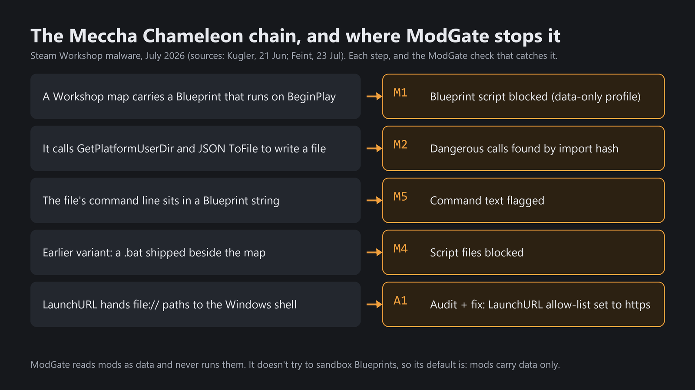

| Step | What happened | ModGate |
|---|---|---|
| 1 | A Workshop map carries a Blueprint actor that runs on `BeginPlay` | **M1**, blocked under `data-only` |
| 2 | It calls `GetPlatformUserDir`, then the JSON plugin's `ToFile`, to write `Documents\s.bat` | **M2**, both calls found through the package's import table |
| 3 | The batch file's command line is stored as a Blueprint string | **M5**, command text |
| 4 | An earlier proof of concept shipped a `.bat` beside the map | **M4**, script file |
| 5 | The batch file was run through `LaunchURL`, which on Windows hands non-web URLs to the shell | **Audit A1**, fixed by `-Audit -Fix` |

The incident was written up by Khael Kugler ("2-Click Remote Code Execution in Meccha Chameleon", 21 June 2026) and
Feint ("Workshop map for MECCHA CHAMELEON is a malware dropper", 23 July 2026). Both are worth reading if you run
mod support. The map was Laser Tag Neon, Workshop item 3765145606.

## Install

### The release zip (no compiler needed)

The [latest release](https://github.com/gregorik/ModGate/releases/latest) has one Win64 zip per engine. Each holds the
compiled editor modules and the source (the tests are left out).

| Zip | Built against |
|---|---|
| `ModGate-1.0.0-UE5.5-Win64.zip` | UE 5.5.4 |
| `ModGate-1.0.0-UE5.6-Win64.zip` | UE 5.6.1 |
| `ModGate-1.0.0-UE5.7-Win64.zip` | UE 5.7.4 |
| `ModGate-1.0.0-UE5.8-Win64.zip` | UE 5.8.3 |

1. Unzip it into your project's `Plugins` folder, so you end up with `YourGame/Plugins/ModGate/ModGate.uplugin`.
2. Open the project. If ModGate isn't enabled, turn it on in **Edit > Plugins** (search "ModGate") and restart.

Before publishing I loaded every zip in a fresh content-only project and scanned the test mods: the scripted one came
back blocked (exit 2), the data-only one clean (exit 0), and nothing was recompiled. On a different patch of the same
engine, Unreal may offer to rebuild the modules, which needs a C++ toolchain.

### From source

```bash
cd YourGame/Plugins
git clone https://github.com/gregorik/ModGate.git ModGate
```

Regenerate project files and build, like any code plugin (Visual Studio with the C++ game development
workload). The descriptor in this repo has no `EngineVersion`, so the same checkout builds on 5.5, 5.6, 5.7 and 5.8.
The cooked test mods come with it, so the [tests](#tests) run straight away.

### On Fab

The same plugin is going on [Fab](https://www.fab.com/sellers/GregOrigin), free, for people who'd rather install from
the launcher. Same code, under Fab's license there. The full manual is also on the web at
[gregorigin.com/Manuals/ModGate](https://gregorigin.com/Manuals/ModGate).

## Quick start

### In the editor

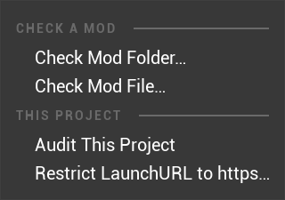 ModGate menu: Check Mod Folder, Check Mod File, Audit This Project, Restrict LaunchURL to https" width="320" align="right">

Everything lives under **Tools > ModGate**:

- **Check Mod Folder…** or **Check Mod File…** picks a mod and scans it. The scan runs in a separate
  `UnrealEditor-Cmd` process, so a malformed file can't take your editor down with it. The HTML report opens when it's
  done, and both reports are kept in `Saved/ModGate/Reports/`.
- **Audit This Project** checks how exposed your own project is (see [the audit](#the-project-audit-and-the-launchurl-fix)).
- **Restrict LaunchURL to https…** writes the fix, after asking.

A Workshop item folder as downloaded, a mod.io `.zip`, a single `.pak`: point it at whatever your players would
receive.

<br clear="right">

### Headless

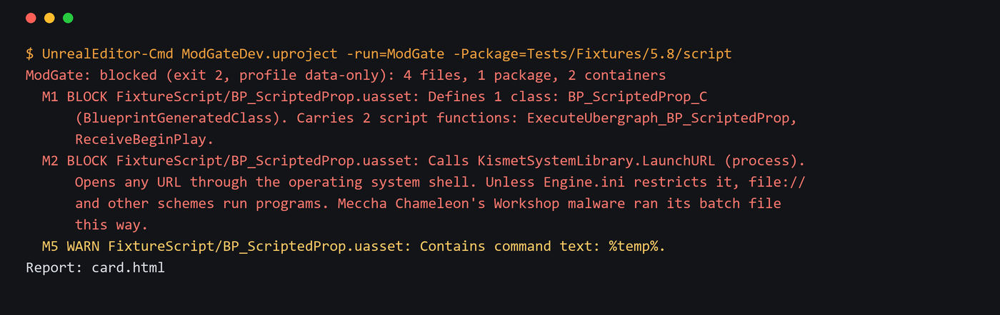

```bash
UnrealEditor-Cmd.exe MyGame.uproject -run=ModGate -Package="D:\Workshop\3765145606"
UnrealEditor-Cmd.exe MyGame.uproject -run=ModGate -Package=Mod.zip -Profile=blueprint-mods -Report=out\mod.json
UnrealEditor-Cmd.exe MyGame.uproject -run=ModGate -Audit
UnrealEditor-Cmd.exe MyGame.uproject -run=ModGate -Audit -Fix -AllowSchemes=https,steam
```

Run it from your game's own project or from your mod kit, not from an empty project. Then every game class and plugin
a mod might reference is loaded, and ModGate can put a name to every native reference instead of raising M9.

It's quick enough to run on every upload. Scanning a whole cooked base game (395 to 494 packages in my tests) took
6.4 to 8.4 seconds, editor start-up included, and most of that is the start-up.

## Reading a report

Every scan writes a JSON report for your tools and an HTML one for people. Every finding says what was found, why it
matters and what to do about it.

<table>
<tr>
<td width="50%">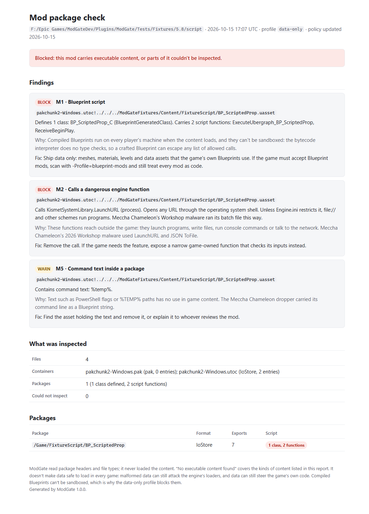</td>
<td width="50%">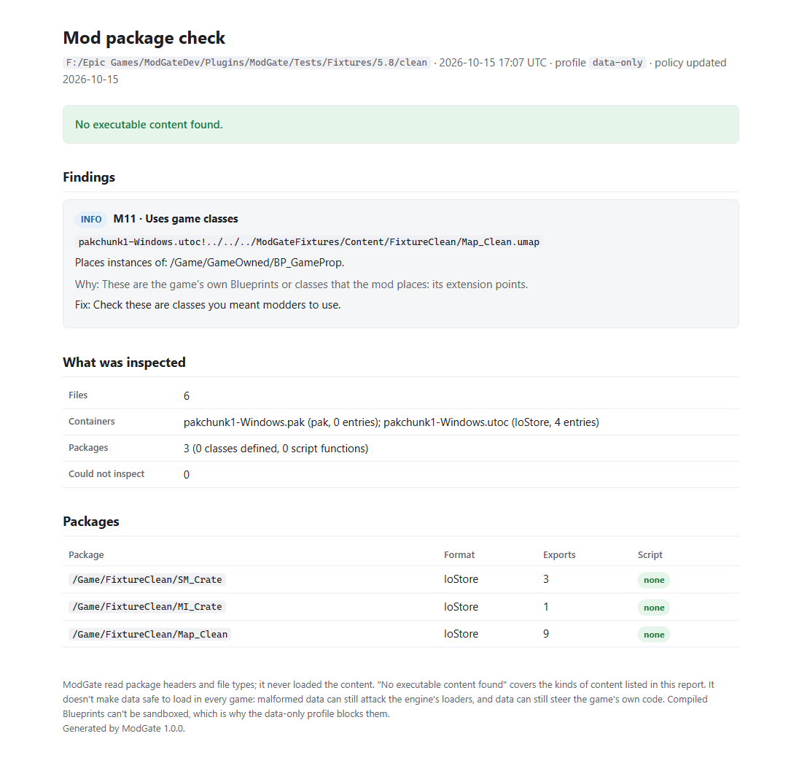</td>
</tr>
<tr>
<td align="center">The scripted test mod: <b>blocked</b></td>
<td align="center">The data-only test mod: <b>clean</b></td>
</tr>
</table>

The JSON is the same information, stable at `schema` 1. Here's one finding from the scripted test mod, as the 5.8
release build wrote it:

```json
{
  "rule": "M2",
  "severity": "block",
  "path": "pakchunk2-Windows.utoc!../../../ModGateFixtures/Content/FixtureScript/BP_ScriptedProp.uasset",
  "title": "Calls a dangerous engine function",
  "detail": "Calls KismetSystemLibrary.LaunchURL (process). Opens any URL through the operating system shell. Unless Engine.ini restricts it, file:// and other schemes run programs. Meccha Chameleon's Workshop malware ran its batch file this way.",
  "why": "These functions reach outside the game: they launch programs, write files, run console commands or talk to the network. Meccha Chameleon's 2026 Workshop malware used LaunchURL and JSON ToFile.",
  "fix": "Remove the call. If the game needs the feature, expose a narrow game-owned function that checks its inputs instead."
}
```

Next to the findings there's an `inventory` with every package: the classes it defines, how many script functions it
carries, the native functions it calls, the game classes it uses and any command text. That's the part to keep with the
submission if you moderate by hand.

## The project audit and the LaunchURL fix

Unreal 5.5 to 5.8 filter `UKismetSystemLibrary::LaunchURL` through `[SystemLibrary.LaunchURLFilter <scheme>]`
sections in Engine.ini, and ship none of them. With no section the filter lets everything through, so any Blueprint,
yours or a modder's, can open any URL. On Windows a `file://` URL goes to `ShellExecute`, which runs whatever it points
at. That was the last step of the 2026 Workshop malware, and it's one empty config section.

`-run=ModGate -Audit` (or **Tools > ModGate > Audit This Project**) writes `Saved/ModGate/ProjectAudit.html`:

| Check | What it looks at |
|---|---|
| **A1: the `LaunchURL` allow-list** | Builds the engine's own `FURLRequestFilter` from your config, the way `LaunchURL` builds it, and asks it whether a `file://` URL gets through. |
| **A2: dangerous functions Blueprints can reach** | The policy's functions present in this build. It warns about optional plugins that expose file writes or processes, such as `JsonBlueprintUtilities.ToFile`. Editor-only modules are listed apart: they matter for cooked-editor mod kits, not packaged games. |
| **A3: your own functions to review** | Your Blueprint-callable functions whose names suggest file, process, console or network access. |

<table>
<tr>
<td width="50%">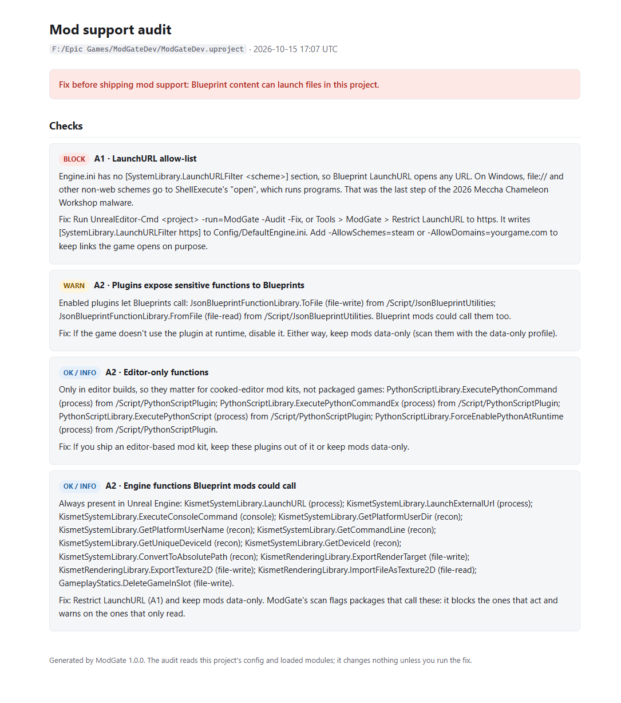</td>
<td width="50%">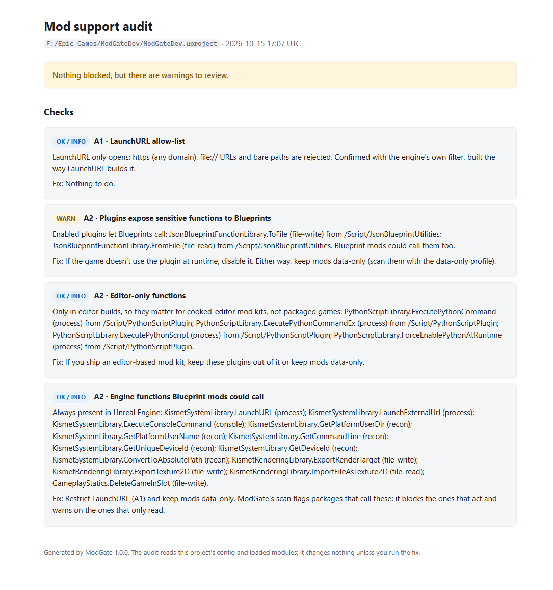</td>
</tr>
<tr>
<td align="center">Before: <b>A1 blocks</b></td>
<td align="center">After the fix and a restart: <b>A1 passes</b></td>
</tr>
</table>

**The fix.** `-Audit -Fix`, or **Restrict LaunchURL to https…**, writes this to `Config/DefaultEngine.ini`:

```ini
[SystemLibrary.LaunchURLFilter https]
!AllowedDomains=ClearArray
```

- It backs the file up once first, to `DefaultEngine.ini.modgate-backup`. Running it again changes nothing.
- It replaces any `LaunchURLFilter` sections you already have, and refuses to allow the `file` scheme.
- It takes effect the next time the editor or game starts.
- `-AllowSchemes=https,steam` keeps schemes your game opens on purpose. `-AllowDomains=yourgame.com` narrows it to
  your own domains.

## Putting it in your upload pipeline

ModGate fits wherever a mod passes through your hands before players get it: the Workshop or mod.io submission tool,
a moderation queue, a build step that bundles curated mods. A minimal gate on a Windows build agent:

```powershell
$editor  = "C:\Program Files\Epic Games\UE_5.8\Engine\Binaries\Win64\UnrealEditor-Cmd.exe"
$project = "D:\MyGame\MyGame.uproject"
$upload  = "D:\Uploads\$env:UPLOAD_ID"
$report  = "D:\Reports\$env:UPLOAD_ID.json"

& $editor $project -run=ModGate "-Package=$upload" "-Report=$report" -FailOnWarn -unattended -nullrhi -nosplash
if ($LASTEXITCODE -ne 0) {
    Write-Error "Rejected (exit $LASTEXITCODE). Findings: $report"
    exit 1
}
```

A few things I'd do:

- **Use `-FailOnWarn`** at upload time. Warnings then come back as 2, and anything that isn't 0 is rejected.
- **Treat unknown exit codes as blocked.** 0 to 3 are ModGate's own. Anything else means the process stopped, and the
  snippet above already rejects it. See [What it isn't](#what-it-isnt) for why that can happen.
- **Keep the JSON** with the submission. It's stable (`schema` 1) and it's your record of what was in the mod.
- **Mount only what passed.** ModGate 1.0 checks; it doesn't enforce anything when your game mounts a pak.
- **Scan what players will download**, not the modder's source project. The cooked containers are what runs.

## Reference

### Inputs

`-Package=` (or `-Input=`) takes:

- **A folder**, such as a Workshop item or an unpacked download. It's scanned recursively.
- **A container:** a `.pak`, or an IoStore `.utoc`/`.ucas` pair.
- **A `.zip`**, such as a mod.io download. It's extracted to `Saved/ModGate/Extract` and deleted after the scan.
  Entries whose paths would leave the folder ("zip slip") aren't extracted, and they're reported.
- **A package file:** `.uasset` or `.umap`, plus its `.uexp`.

### Command line

| Option | What it does |
|---|---|
| `-Package=<path>` | What to scan. `-Input=` works too. |
| `-Profile=<name>` | `data-only` (default) or `blueprint-mods`, or a profile from your own policy. |
| `-Policy=<file>` | Use your own policy JSON instead of `Resources/ModGatePolicy.json`. |
| `-Report=<file.json>` | Where to write the reports (the `.html` goes next to it). Default: `<input>.modgate.json` and `.html`. |
| `-FailOnWarn` | Return 2 instead of 1 when the worst finding is a warning. |
| `-Audit` | Audit the project instead of scanning a mod. |
| `-Fix` | With `-Audit`: write the `LaunchURL` allow-list. |
| `-AllowSchemes=a,b` | With `-Fix`: schemes to allow. Default `https`. `file` is refused. |
| `-AllowDomains=a,b` | With `-Fix`: limit the allowed schemes to these domains. |

The log category is `LogModGate`.

### Exit codes

| Code | Meaning |
|---|---|
| **0** | Clean: no executable content found |
| **1** | Warnings to review (`-FailOnWarn` turns these into 2) |
| **2** | Blocked |
| **3** | Input or report error: a missing file, a bad policy, an unknown profile |
| anything else | The process stopped. Unreal's own container readers treat some malformed files as fatal errors. **Treat it as blocked.** |

### Reports

- `<input>.modgate.json` and `.html` by default, or wherever `-Report=` points. Both are written atomically, so a
  half-written report never appears.
- Each finding has `rule`, `severity`, `title`, `path`, `detail`, `why` and `fix`.
- `summary` counts files, containers, packages, classes defined, script functions, problems, blocks and warnings.
- `inventory` lists every container and package, as described in [Reading a report](#reading-a-report).

### Policy

The default policy is [`Resources/ModGatePolicy.json`](Resources/ModGatePolicy.json). To change anything, copy it,
edit the copy and pass `-Policy=<path>`. Here's what's in it:

| Section | In the default policy |
|---|---|
| `profiles` | `data-only` and `blueprint-mods`: a severity (`block`, `warn`, `info`, `off`) for each rule |
| `riskyFunctions` | 31 engine functions in 6 modules: 9 recon, 9 file-write, 6 process, 2 file-read, 2 browser, 2 network, 1 console |
| `folderAllowedExtensions` | What may sit loose in a mod folder: `.pak`, `.utoc`, `.ucas`, images, `.json`, `.vdf` and a few more |
| `containerAllowedExtensions` | What may sit inside a container: `.uasset`, `.uexp`, `.umap`, `.ubulk`, localisation, fonts, audio, video… |
| `nativeExtensions`, `scriptExtensions`, `configExtensions`, `shaderExtensions` | The file types behind M3, M4, M6 and M10 |
| `executableClasses` | Export classes that count as script for M1 (`BlueprintGeneratedClass`, `Function` and so on) |
| `suspiciousStrings` | The command text behind M5 |
| `riskyNamePattern` | The name pattern the audit's A3 uses on your own functions |

A function entry looks like this. Add your own game's or plugins' functions the same way:

```json
{
  "path": "/Script/Engine.KismetSystemLibrary:LaunchURL",
  "category": "process",
  "severity": "block",
  "why": "Opens any URL through the operating system shell. Unless Engine.ini restricts it, file:// and other schemes run programs. Meccha Chameleon's Workshop malware ran its batch file this way."
}
```

A policy that doesn't parse is an input error (exit 3), and M8 is always a block whatever the policy says.

## How it works

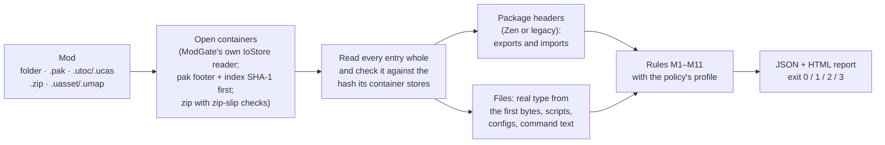

- **Nothing is loaded.** ModGate never mounts a pak, never creates a `UObject` from the mod and never runs its
  script. It reads bytes and parses headers.
- **Every container entry is read whole and checked** against the hash its container stores: BLAKE3 per IoStore
  chunk, SHA-1 per pak entry, CRC-32 per zip entry. A mismatch, a truncation or a block that won't decompress is an M8
  block. That's what makes damaged downloads fail closed rather than half-scanned.
- **ModGate has its own IoStore reader.** Epic's `FIoStoreReader` trusts the `.utoc`, and a cut-off or corrupted one
  makes it assert and end the process. ModGate's reader handles the same format (TOC versions 2 to 8, the same across
  5.5 to 5.8), checks every size, index and offset against the file before using it, and decompresses blocks with
  `FCompression`, which reports failure instead of asserting.
- **M1, Blueprint script:** an export whose class is a class type (`BlueprintGeneratedClass`,
  `WidgetBlueprintGeneratedClass`, …) or a function type is executable content.
- **M2, dangerous calls by import hash:** a cooked IoStore package doesn't store the names of the engine objects it
  uses. It stores a CityHash64 of each one's lowercase path. ModGate hashes the policy's functions the same way, so it
  recognises `KismetSystemLibrary.LaunchURL` or `JsonBlueprintFunctionLibrary.ToFile` even when the plugin that defines
  the function isn't loaded in the editor doing the scan.
- **M3 looks at bytes, not names.** A file whose first bytes are a Windows executable header is native code, whatever
  its extension says.
- **The editor menu scans out of process**, so the one part ModGate doesn't own (below) can't crash your editor.

## What it isn't

I'd rather you read this section before you rely on it.

- **It isn't a sandbox.** It doesn't try to make Blueprint mods safe, because they can't be (see
  [What it checks](#what-it-checks)). That's why the default profile blocks Blueprint script outright.
- **It isn't an antivirus and it doesn't detect malware.** It tells you a mod carries something executable. Whether
  that's malicious is your call, and under `data-only` you don't have to make it: the mod doesn't ship.
- **A clean result isn't a promise that the data is safe to load.** It means ModGate found none of the kinds of
  executable content listed above. Malformed data can still attack the engine's own loaders, and data can still steer
  your game's code. M11 lists the game classes a mod places; check they're the ones you meant to expose.
- **Same engine version only.** Cooked IoStore headers carry no version number, so each build of ModGate reads
  packages cooked by its own engine version. Packages from another version fail closed (M8).
- **Encrypted containers** can't be inspected (M8). Neither can IoStore containers split across several `.ucas`
  partitions, or ZIP64 archives. Mods are normally neither, and all of them fail closed.
- **Pak indexes are still parsed by Epic's `FPakFile`.** ModGate checks the pak footer and the index's own SHA-1 first,
  which stops accidental damage. A deliberately crafted pak whose index hash is valid could still make Epic's reader
  stop the process. That's why the editor scans out of process, and why CI should treat any exit code other than 0 to 3
  as blocked.
- **It checks, it doesn't enforce.** 1.0 has no runtime gate. Mount only what passed.

## Tests

28 automation tests, in [`Source/ModGate/Private/Tests`](Source/ModGate/Private/Tests):

| Area | Tests | What they cover |
|---|:---:|---|
| `ModGate.Rules` | 4 | Script and dangerous calls, a data-only mod staying clean, failing closed, file types |
| `ModGate.Fixtures` | 5 | The cooked test mods: IoStore, legacy pak, extras and zip, an uncooked Blueprint, and that they're present |
| `ModGate.Policy` | 4 | Parsing and validation, the shipped policy, every listed engine function existing, hashes matching the cooker's |
| `ModGate.Files` | 4 | Extensions, magic bytes, ini and plugin descriptors, command-text search |
| `ModGate.Audit` | 3 | Parsing and probing the URL filter, the verdict, the fix writing the allow-list |
| `ModGate.Zip` | 2 | Safe entry names, extraction skipping unsafe entries |
| `ModGate.Reader` | 2 | Name-batch bounds, legacy engine assets |
| `ModGate.Robustness` | 1 | 12 damaged downloads (`.utoc`, `.ucas`, paks, a package and zips, cut short, corrupted or missing): each exits 2 with M8, none crashes |
| `ModGate.Scanner`, `.Report`, `.Run` | 3 | Folder scans, JSON and HTML output, exit codes and report paths |

They run against cooked test mods in [`Tests/Fixtures/<engine>`](Tests/Fixtures), one set per engine, about 300 KB in
all:

- a data-only mod: a mesh, a material instance and a map that places a game-owned Blueprint;
- a scripted mod, whose Blueprint does nothing but print a line and open example.com on `BeginPlay`;
- the same two as legacy paks;
- an "extras" pak of inert files the rules care about: an `.ini`, a plugin descriptor with a code module, a `.png`
  that starts with an executable header, an unknown extension;
- an uncooked Blueprint.

None of them do anything harmful, by design. Run the tests from **Tools > Test Automation** with the filter `ModGate`,
or:

```bash
UnrealEditor-Cmd.exe YourGame.uproject -ExecCmds="Automation RunTests ModGate; Quit" -unattended -NullRHI
```

For 1.0.0, all 28 pass on UE 5.5, 5.6, 5.7 and 5.8, each in a fresh host project. The plugin also builds with strict
includes (no PCH, no unity). The release zips leave the tests out, as the Fab package does; clone the repo to run
them.

## Supported engines and platforms

- **Engines:** UE 5.5, 5.6, 5.7 and 5.8.
- **Where it runs:** the Win64 editor and commandlet. Both modules also compile for Linux: every file is compiled with
  each engine's own Linux clang and its warnings-as-errors set. That check is compile-only. I haven't run ModGate in a
  Linux editor, and macOS isn't claimed.
- **Mods for any target platform:** it reads mods cooked for Windows, Linux and Android (ASTC). I checked that on all
  four engines with a data-only mod, a scripted mod and a whole base game.
- **Nothing in your game:** both modules are editor modules, and Unreal only compiles those into editor targets. With
  ModGate enabled, I packaged Win64, Linux and Android builds in Development and Shipping on all four engines, started
  them, and searched every binary. None of ModGate's code was in any of them.

## Roadmap

Not in 1.0, and built only if studios ask:

- a runtime gate that refuses to mount mods that weren't checked or signed;
- Steam Workshop and mod.io upload hooks;
- an allow-list for the game classes mods may use.

If one of those would decide whether you use ModGate, tell me on [Discord](https://discord.gg/nqYQ5mtmHb).

## FAQ

**Why not just block `.exe` files?** That's what Meccha Chameleon did first, and the malware walked straight past it.
The dangerous part was a Blueprint inside an ordinary container. You have to look inside the packages, which is the
whole point of ModGate.

**Does it slow my game down?** It isn't in your game. Both modules are editor-only (see above).

**My game already accepts Blueprint mods. Is this any use?** Yes, with `-Profile=blueprint-mods`. It still blocks
known-dangerous calls, native code and scripts, and it lists what each mod's Blueprints call. It can't make Blueprint
mods safe, and the report says so.

**Can I ship it in my mod kit, so modders check their work before uploading?** Yes. That's one of the reasons it's
MIT here: you can redistribute it, source included, and change it. Keep the license notice.

**Can I use it in a commercial game or a paid service?** Yes. MIT: use it, change it, ship it.

**Does it work on UE 5.4 or UE4?** It isn't supported there. Cooked package headers change between versions, and I've
only built and tested 5.5 to 5.8.

**Can it scan a mod cooked for Android on my Windows PC?** Yes. The container formats are the same; it reads mods
cooked for Windows, Linux and Android.

**Why does it need my game's project to run?** It doesn't need it, but it's better with it. Run from an empty project,
ModGate can't name native references to your game's classes and raises M9 warnings instead.

**Is the Fab version different?** No. Same code, built from the same source. Fab's copy is under Fab's license; this
one is MIT.

## Found a bypass?

If you have a mod that should be blocked and isn't, please don't post it in a public issue. Report it privately
through GitHub's [**Report a vulnerability**](https://github.com/gregorik/ModGate/security/advisories/new) form on the
Security tab, or message me on [Discord](https://discord.gg/nqYQ5mtmHb). Describe the technique; don't attach live
malware. I'll fix it, add a test for it and credit you if you'd like.

## Contributing

Issues and pull requests are welcome. Most useful of all:

- **Policy additions:** an engine or popular plugin function that lets Blueprints touch files, processes or the
  network and isn't in `riskyFunctions` yet. Include the path, the category and a one-line `why`.
- **Real-world false positives:** a mod that's genuinely data-only but gets flagged.
- **Container edge cases:** a valid mod layout ModGate can't read.

Changes should keep all 28 tests passing on 5.5 to 5.8, and new rules need a test.

## License

[MIT](LICENSE), © 2026 [GregOrigin](https://www.gregorigin.com). Built by
[Andras Gregori](https://github.com/gregorik). The copy on Fab is the same code under Fab's license.

If ModGate catches something nasty in your pipeline, I'd like to hear about it.
